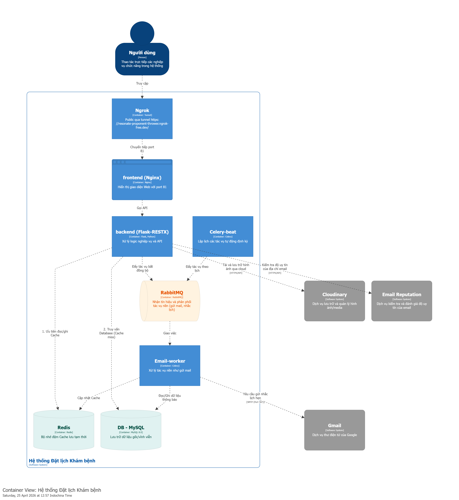

# Hệ thống đặt lịch khám bệnh (Medical Appointment)

## Mô tả 
Hệ thống cho phép bệnh nhân đặt lịch khám bệnh online, tìm bác sĩ theo chuyên khoa. Hỗ trợ lưu trữ và quản lý hồ sơ bệnh nhân và quản lý bác sĩ, lịch làm việc và theo dõi các lịch khám đã đặt cho các Phòng khám/bệnh viện.

## Thành viên nhóm 
| MSSV | Họ tên | Vai trò | 
|------|--------|---------|
| 2351050164 | Văn Trung Thành | Nhóm trưởng | 
| 2351050133 | Nguyễn Thanh Phong | Thành viên |
| 2351050154 | Trương Hưng Phát | Thành viên |

## Công nghệ sử dụng
- Quản trị CSDL: MySQL
- Thư viện: React
- Ngôn ngữ: JavaScript
- Framework: ViteJS
- Message-queue: RabbitMQ
- Container: Docker và Docker Compose

## Kiến trúc
[Mô tả kiến trúc đã chọn] 
 

## Cài đặt và chạy 

### Yêu cầu
- Docker Desktop
- Git

### Chạy với Docker Compose 
git clone https://github.com/username/project-name 
cd project-name 
docker-compose up -d 

### Truy cập
- Frontend: http://localhost:3000 
- Backend API: http://localhost:8000 
- RabbitMQ Management: http://localhost:15672 

## Demo 
- [Medical-Appointment-Demo](https://drive.google.com/drive/u/0/folders/1DxsuBUrXGs3e7ExIcdaz8nEen7Jye9QF)

## Tài liệu
- [ADRs](docs/adrs/) 
- [API Documentation](docs/api/) 
- [Architecture](docs/architecture/) 